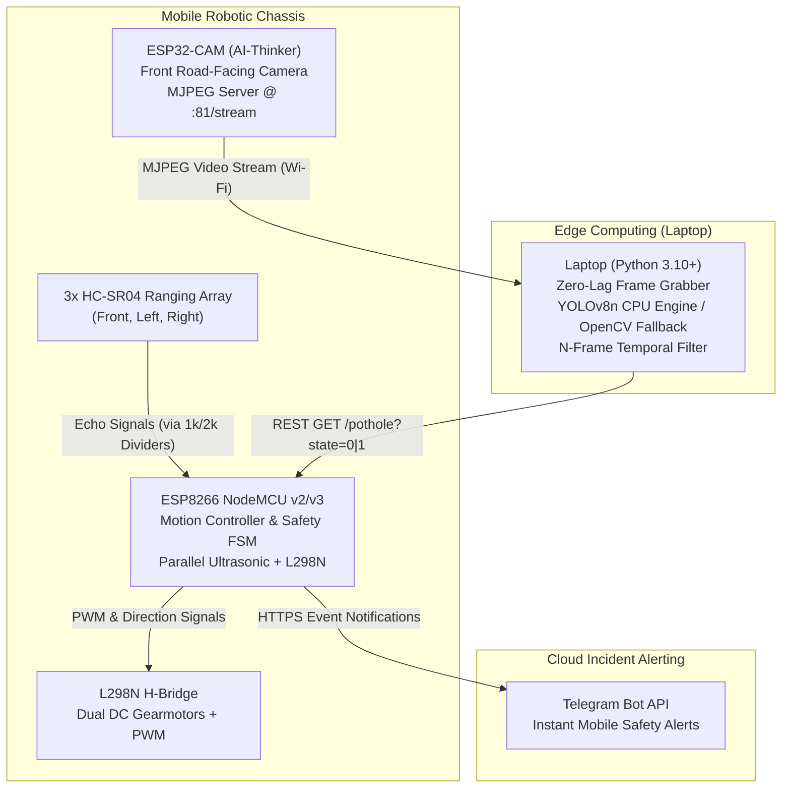

# AI-Driven Pothole Identification & Smart Obstacle Avoidance System

An intelligent, distributed cyber-physical robotic platform that combines embedded ultrasonic distance sensing with computer-vision AI to achieve autonomous obstacle avoidance and road defect (pothole) mitigation.

---

## 1. System Overview & Architecture

The system coordinates three nodes operating over a local Wi-Fi network:



### Core Operating Principles
1. **Pothole Detection & Smooth Slowdown**:
   - The ESP32-CAM streams video at $320 \times 240$ resolution ($15–25\text{ FPS}$) to the laptop.
   - The laptop AI evaluates the road Region of Interest (lower 50% of the camera FOV).
   - Upon confirming a pothole across $N=3$ consecutive frames, the laptop issues `GET /pothole?state=1`.
   - The ESP8266 smoothly throttles motor speed down to crawl speed ($43\%\text{ PWM}$) so the vehicle traverses the rough patch without abrupt braking or losing steering control.
   - When the pothole is cleared ($M=10$ clear frames), speed ramps back to normal cruise ($70\%\text{ PWM}$).
2. **Autonomous Ultrasonic Obstacle Avoidance**:
   - The ESP8266 samples Front, Left, and Right HC-SR04 ultrasonic sensors at $15\text{ Hz}$ using an optimized parallel-sampling driver.
   - If an obstacle appears $< 25\text{ cm}$ ahead, obstacle evasion **immediately overrides** road surface state.
   - The vehicle compares Left and Right clearance, pivots toward the more open side (`AVOID`), overtakes the obstacle (`PASS`), and counter-steers back to its original lane heading (`RETURN`).
   - If all three directions are blocked ($< 15\text{ cm}$), the vehicle halts safely (`BLOCKED`) and transmits a priority Telegram alert.

---

## 2. Directory Structure

```
pothole-avoidance/
 ├─ README.md                                  # Complete system manual & documentation
 ├─ telegram_setup.md                          # Telegram BotFather step-by-step setup guide
 ├─ docs/
 │   ├─ wiring_diagram.md                      # Complete electrical schematics & pinout tables
 │   ├─ architecture.md                        # Distributed network protocols & FSM specification
 │   └─ test_plan.md                           # 7-stage bring-up validation & calibration manual
 ├─ esp32cam_stream/
 │   └─ esp32cam_stream.ino                    # AI-Thinker MJPEG stream firmware on port 81 (/stream)
 ├─ esp8266_controller/
 │   ├─ config.h                               # Wi-Fi credentials, pinouts, PWM speeds & thresholds
 │   └─ esp8266_controller.ino                 # Non-blocking FSM, parallel ultrasonic sampler, REST server
 └─ laptop_ai/
     ├─ requirements.txt                       # Python dependencies (opencv-python, numpy, ultralytics)
     ├─ config.py                              # Central vision thresholds, URLs, and ROI parameters
     ├─ esp_client.py                          # Non-blocking HTTP REST client with state-change filter
     ├─ pothole_fallback.py                    # Classical OpenCV edge & dark-crater detector
     ├─ train_model.py                         # YOLOv8n training pipeline and ONNX CPU export
     ├─ detect_stream.py                       # Main application: zero-lag threaded grabber, AI HUD
     ├─ test_stream.py                         # Camera stream latency and FPS diagnostic tool
     └─ test_esp8266_link.py                   # REST endpoint and motor actuation test script
```

---

## 3. Hardware Bill of Materials (BOM)

| Component | Quantity | Purpose |
|---|---|---|
| **ESP8266 NodeMCU v2 / v3** | 1 | Vehicle motion controller, REST server & Telegram client |
| **ESP32-CAM (AI-Thinker)** | 1 | Low-latency MJPEG video streamer |
| **FTDI USB-to-UART Adapter** | 1 | Flashing the ESP32-CAM |
| **HC-SR04 Ultrasonic Sensors** | 3 | Front, Left, and Right obstacle distance ranging |
| **L298N Dual H-Bridge Driver** | 1 | DC motor direction and PWM speed actuation |
| **2WD / 4WD Robot Chassis** | 1 | Chassis, wheels, and geared DC motors ($3\text{V}–6\text{V}$) |
| **DC-DC Step-Down Buck Converter** | 1 | LM2596 or MP1584 (tapped from battery down to $5.05\text{V}$) |
| **$470\ \mu\text{F}$ Electrolytic Capacitor** | 1 | Placed across ESP32-CAM 5V and GND (prevents brownouts) |
| **Resistors (1/4 W)** | 3x $1\text{ k}\Omega$, 3x $2\text{ k}\Omega$ | $5\text{V} \to 3.3\text{V}$ Voltage dividers for HC-SR04 ECHO pins |
| **Resistors (1/4 W)** | 2x $10\text{ k}\Omega$ PU, 1x $10\text{ k}\Omega$ PD | Bootstrapping protection for ESP8266 GPIO0, GPIO2, GPIO15 |
| **Battery Pack (7.4V–11.1V)** | 1 | 2S Li-ion (7.4V) or 3S LiPo (11.1V) with power switch |

---

## 4. Hardware Pinout & Wiring Summary

### NodeMCU ESP8266 Pin Connections
```
                     +----------------------------+
                     |    ESP8266 NodeMCU v2/v3   |
                     +----------------------------+
       L298N IN1 <---| D1 (GPIO 5)       D5 (GPIO 14) |---> Shared HC-SR04 TRIG (x3)
       L298N IN2 <---| D2 (GPIO 4)       D6 (GPIO 12) |<--- FRONT ECHO (via 1k/2k divider)
   L298N IN3 (PU)<---| D3 (GPIO 0)       D7 (GPIO 13) |<--- LEFT ECHO  (via 1k/2k divider)
 L298N ENA+B (PU)<---| D4 (GPIO 2)       D0 (GPIO 16) |<--- RIGHT ECHO (via 1k/2k divider)
   L298N IN4 (PD)<---| D8 (GPIO 15)               VIN |<--- 5.0V Regulated from Buck Converter
                     | GND                        GND |---> Common System Star Ground
                     +----------------------------+
```

> [!CAUTION]
> **Critical Bootstrapping Pin Safeguards:**
> - **D3 (GPIO0)**: Connected to L298N IN3. Add an external **$10\text{ k}\Omega$ pull-up resistor to 3.3V**. If held low at boot, the ESP enters UART flash mode and never runs code!
> - **D8 (GPIO15)**: Connected to L298N IN4. Add an external **$10\text{ k}\Omega$ pull-down resistor to GND**. Must be low at boot.
> - **D4 (GPIO2)**: Tied to L298N ENA+ENB. Add an external **$10\text{ k}\Omega$ pull-up resistor to 3.3V**.

For comprehensive schematics and ASCII diagrams, consult [docs/wiring_diagram.md](file:///c:/Users/chara/Desktop/Pothole%20Identification/pothole-avoidance/docs/wiring_diagram.md).

---

## 5. Software Setup & Installation

### A) ESP32-CAM Setup
1. Open Arduino IDE. Add the ESP32 board URL in **Preferences**:
   ```text
   https://raw.githubusercontent.com/espressif/arduino-esp32/gh-pages/package_esp32_index.json
   ```
2. Open [esp32cam_stream/esp32cam_stream.ino](file:///c:/Users/chara/Desktop/Pothole%20Identification/pothole-avoidance/esp32cam_stream/esp32cam_stream.ino).
3. Update `WIFI_SSID` and `WIFI_PASSWORD`.
4. Connect FTDI adapter to ESP32-CAM:
   - `FTDI VCC` $\to$ `ESP32-CAM 5V`
   - `FTDI GND` $\to$ `ESP32-CAM GND`
   - `FTDI TX` $\to$ `U0R (GPIO3)`
   - `FTDI RX` $\to$ `U0T (GPIO1)`
   - **Connect GPIO0 to GND with a jumper wire**.
5. Select Board: **AI Thinker ESP32-CAM**, Flash Frequency: **80MHz**, Partition: **Huge APP (3MB No OTA)**.
6. Click **Upload**. When done, **disconnect GPIO0 from GND**, press the onboard RST button, and note the assigned IP address from the Serial Monitor (115200 baud).

---

### B) ESP8266 Vehicle Controller Setup
1. In Arduino IDE, install the ESP8266 board package:
   ```text
   http://arduino.esp8266.com/stable/package_esp8266com_index.json
   ```
2. Install the **ArduinoJson** library (v6.x or v7.x) via the Library Manager.
3. Open [esp8266_controller/config.h](file:///c:/Users/chara/Desktop/Pothole%20Identification/pothole-avoidance/esp8266_controller/config.h).
4. Update `WIFI_SSID`, `WIFI_PASSWORD`, and your Telegram credentials:
   ```cpp
   #define TELEGRAM_BOT_TOKEN  "YOUR_BOT_TOKEN"
   #define TELEGRAM_CHAT_ID    "YOUR_CHAT_ID"
   ```
   *(See [telegram_setup.md](file:///c:/Users/chara/Desktop/Pothole%20Identification/pothole-avoidance/telegram_setup.md) for instructions on creating your bot).*
5. Select Board: **NodeMCU 1.0 (ESP-12E Module)** and upload [esp8266_controller.ino](file:///c:/Users/chara/Desktop/Pothole%20Identification/pothole-avoidance/esp8266_controller/esp8266_controller.ino).
6. Note the controller's IP address from Serial Monitor (e.g., `192.168.1.60`).

---

### C) Laptop Python AI Environment Setup
1. Ensure Python 3.10+ is installed.
2. Open a terminal in `laptop_ai/` and install required dependencies:
   ```bash
   cd laptop_ai
   python -m venv venv
   # On Windows:
   venv\Scripts\activate
   # On Linux / macOS:
   source venv/bin/activate

   pip install -r requirements.txt
   ```
3. Open [laptop_ai/config.py](file:///c:/Users/chara/Desktop/Pothole%20Identification/pothole-avoidance/laptop_ai/config.py) and update the IP addresses matching your boards:
   ```python
   ESP32_CAM_IP = "192.168.1.50"
   ESP8266_IP   = "192.168.1.60"
   ```

---

## 6. Quick Start & Execution

### 1. Run with Real-World Road Video (`pothole_video.mp4`)
Run the AI vision model directly on your recorded road footage with real-time HUD and mock vehicle controller:
```bash
cd laptop_ai
python run_video.py
```
*(Or simply double-click [`pothole-avoidance/run_video.bat`](file:///c:/Users/chara/Desktop/Pothole%20Identification/pothole-avoidance/run_video.bat))*.

### 2. Run with Laptop Webcam (Interactive)
Test the vision model live using your laptop webcam:
```bash
cd laptop_ai
python run_webcam.py
```
*(Or double-click [`pothole-avoidance/run_webcam.bat`](file:///c:/Users/chara/Desktop/Pothole%20Identification/pothole-avoidance/run_webcam.bat))*.

### 3. Run with Simulated Roadway (SITL)
Run the built-in road simulator:
```bash
cd laptop_ai
python run_simulation.py
```
*(Or double-click [`pothole-avoidance/run_simulation.bat`](file:///c:/Users/chara/Desktop/Pothole%20Identification/pothole-avoidance/run_simulation.bat))*.

### 4. Live Hardware Deployment (ESP32-CAM Stream)
When connected to the physical robot:
```bash
python detect_stream.py
```
- The application automatically uses the **Classical OpenCV detector** out-of-the-box (no weights needed).
- Press `f` in the preview window to toggle between YOLOv8n and OpenCV Fallback.
- Press `d` to toggle the dark-crater contour mask.
- Press `q` to safely exit.

### 5. Optional: Train Custom YOLOv8n Weights
To train custom neural network weights on road datasets:
```bash
python train_model.py --epochs 30 --imgsz 320 --export-onnx
```
*(The script automatically converts the trained model to ONNX for CPU acceleration and deploys it to `models/pothole_yolov8n.onnx`)*.

---

## 7. Troubleshooting Guide

| Problem | Root Cause | Solution |
|---|---|---|
| **ESP32-CAM Brownout / Infinite Reboot** | Wi-Fi power burst draws $> 800\text{ mA}$, dropping voltage below $4.6\text{V}$. | Solder a **$470\ \mu\text{F}$ 16V electrolytic capacitor** directly between the ESP32-CAM `5V` and `GND` pins. Ensure buck converter outputs at least $5.05\text{V}$. |
| **ESP8266 Stuck in Bootloader Mode** | GPIO0 (D3) is pulled low by L298N input circuitry at power-up. | Add a **$10\text{ k}\Omega$ pull-up resistor** from D3 to 3.3V, or turn the motor battery power switch ON *after* the NodeMCU boots. |
| **All Ultrasonic Sensors Return 0 cm** | Sequential `pulseIn()` called on shared trigger line. | Use the provided `sampleUltrasonicsParallel()` routine which polls all 3 echo pins simultaneously in a single trigger pulse. |
| **Camera Stream Has High Lag (> 1 sec)** | OpenCV internal frame buffer accumulating old frames. | `detect_stream.py` implements `FreshFrameCapture`, which runs in a daemon thread and continuously purges stale buffered frames. |
| **Motors Twitching or Failing to Turn** | L298N internal voltage drop ($1.8\text{V}$) leaves insufficient voltage from low battery. | Use a minimum 2S Li-ion ($7.4\text{V}$) or 3S LiPo ($11.1\text{V}$) pack. Never power L298N motors directly from the 5V logic rail. |

---

## 8. Engineering Summary

### Assumptions Made
1. **Network Environment**: All three nodes (ESP32-CAM, ESP8266, Laptop) share an unisolated 2.4 GHz 802.11b/g/n Wi-Fi local network with device-to-device routing enabled.
2. **Road Surface**: Road defects (potholes) have distinct edge boundaries and darker crater interiors than the surrounding pavement under typical daylight or illuminated conditions.

### Known Limitations
1. **ESP8266 Pin Budget**: The NodeMCU has only 9 usable GPIOs, requiring careful strapping pin management (GPIO0/GPIO2/GPIO15) and parallel ultrasonic polling.
2. **Wi-Fi Transport Latency**: Under congested 2.4 GHz environments, video latency can fluctuate between 60 ms and 200 ms. At $0.5\text{ m/s}$ chassis speed, a 100 ms latency represents only $5\text{ cm}$ of travel, which is well within the safety margin.

### Future Upgrades
1. **Direct ESP32 Controller Upgrade**: Replacing the ESP8266 with an ESP32 provides 30+ clean GPIO pins, dual-core concurrency, and hardware encoder timer counters.
2. **Optical Flow / Wheel Encoders**: Adding Hall-effect wheel encoders allows precise closed-loop heading and odometry during obstacle bypass maneuvers.
3. **GPS Pothole Cloud Logging**: Integrating a small GPS module (e.g. NEO-6M) on the vehicle to automatically upload geolocated pothole coordinates to OpenStreetMap or a cloud database for municipal road repair teams.
