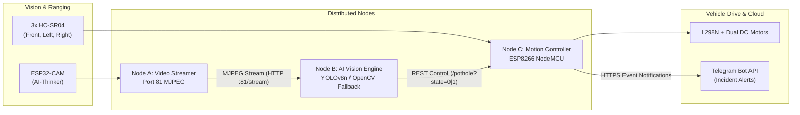
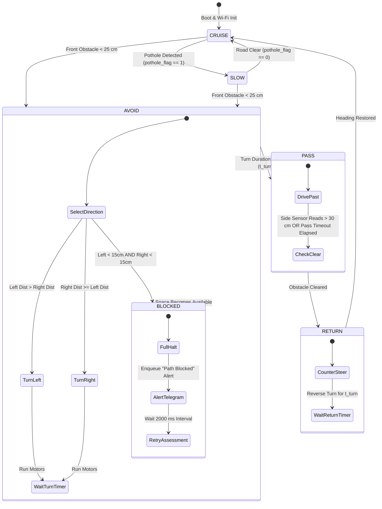
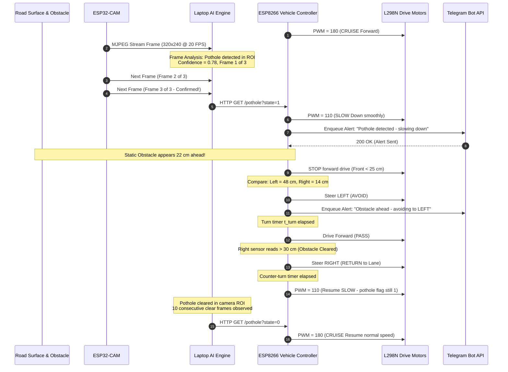

# System Architecture & State Machine Specification

## 1. System Overview

The **AI-Driven Pothole Identification and Smart Obstacle Avoidance System** is a distributed, cyber-physical robotic platform designed for autonomous roadway safety. The architecture separates low-latency physical safety control from high-compute computer vision intelligence across three collaborative computing nodes:

---

## 2. Distributed Communication Protocols

### A) Video Stream: ESP32-CAM -> Laptop
- **Transport**: HTTP multipart/x-mixed-replace over TCP.
- **Port**: `81` (`http://<ESP32CAM_IP>:81/stream`).
- **Resolution**: `QVGA` (320x240 pixels) optimized for transmission latency ($< 80\text{ ms}$).
- **Compression**: JPEG Quality = `12` (balances image clarity for edge/contour detection with minimal packet fragmentation).
- **Network Resilience**: Embedded watchdog auto-reconnects Wi-Fi within $3000\text{ ms}$ of AP disconnection.

### B) Vehicle Command & Telemetry REST API: Laptop <-> ESP8266
The ESP8266 runs an embedded HTTP web server on port `80`. The endpoints follow a deterministic REST interface:

| Endpoint | Method | Query Parameters | Description | Sample Response |
|---|---|---|---|---|
| `/pothole` | `GET` | `state=1` or `state=0` | Signals pothole detection (`1` = slow down) or road clear (`0` = cruise). Dispatched only on state transitions. | `{"status":"ok","pothole":1}` |
| `/status` | `GET` | None | Returns real-time vehicle telemetry (distances, state, PWM, mode). | `{"mode":"AUTO","state":"CRUISE","speed":180,"pothole":0,"front_cm":45.2,"left_cm":38.1,"right_cm":42.0,"uptime_s":45}` |
| `/mode` | `GET` | `auto=1` or `auto=0` | Toggles between Autonomous mode (`1`) and Manual Drive mode (`0`). | `{"status":"ok","mode":"AUTO"}` |
| `/drive` | `GET` | `cmd=F\|B\|L\|R\|S` | Manual motor control (`F`=Forward, `B`=Backward, `L`=Left, `R`=Right, `S`=Stop). Active only in manual mode. | `{"status":"ok","command":"F"}` |

### C) Cloud Notification Interface: ESP8266 -> Telegram Bot API
- **Transport**: HTTPS POST over TLS 1.2 to `https://api.telegram.org/bot<TOKEN>/sendMessage`.
- **Client Security**: `WiFiClientSecure` with `setInsecure()` to avoid heavy X.509 certificate store overhead on the ESP8266 RAM.
- **Non-blocking Dispatch**: Messages are enqueued into a memory ring buffer. The main execution loop dispatches HTTP transactions asynchronously during idle slices between motor control ticks.

---

## 3. ESP8266 Finite State Machine (FSM)

The vehicle motion controller is strictly non-blocking. It uses `millis()` timestamp tracking without any blocking `delay()` calls.

### Detailed State Behavioral Specifications

1. **`CRUISE` (Normal Autonomous Drive)**:
   - Left & Right motors drive forward at normal cruise speed (default: `PWM = 180 / 255`, ~70% duty cycle).
   - Ultrasonic sensors polled continuously at $15\text{ Hz}$ using the non-blocking parallel sampler.
   - Pothole state: `0`.

2. **`SLOW` (Pothole Navigation)**:
   - Left & Right motors drive forward at reduced crawl speed (default: `PWM = 110 / 255`, ~43% duty cycle).
   - The vehicle does **NOT** stop abruptly, preventing rear-end collisions from following vehicles.
   - Transitions back to `CRUISE` smoothly when the laptop signals `pothole=0`.

3. **`AVOID` (Obstacle Evasion Maneuver)**:
   - **Trigger**: Front distance drops below `OBSTACLE_FRONT_THRESH` (default: $25\text{ cm}$).
   - **Arbitration**: Immediately preempts `SLOW` or `CRUISE`. Obstacle avoidance takes top safety priority over road surface conditions.
   - **Decision Engine**:
     - Compares `left_cm` vs `right_cm`.
     - If `left_cm > right_cm` and `left_cm > 20 cm`, pivots **LEFT**.
     - If `right_cm >= left_cm` and `right_cm > 20 cm`, pivots **RIGHT**.
     - If both `left_cm < 15 cm` and `right_cm < 15 cm`, transitions to `BLOCKED`.
   - The pivot turn runs for a calibrated time constant `t_turn` (default: $450\text{ ms}$).

4. **`PASS` (Obstacle Overtaking)**:
   - Vehicle drives straight forward along the bypass trajectory.
   - Monitors the side sensor facing the obstacle (e.g. if steered left, monitors the right sensor).
   - State completes when the side distance exceeds $30\text{ cm}$ (obstacle passed) or after a maximum safety timeout `t_pass` ($1800\text{ ms}$).

5. **`RETURN` (Lane Restoration)**:
   - Vehicle executes a counter-steer maneuver in the opposite direction of the initial evasion for exactly `t_return = t_turn` ($450\text{ ms}$).
   - Returns vehicle chassis parallel to original lane heading, then resumes `CRUISE`.

6. **`BLOCKED` (Deadlock Safety Halt)**:
   - All motors instantly forced to $0\text{ PWM}$ (electric brake).
   - Enqueues an urgent alert to Telegram: `"🚨 EMERGENCY: Path completely blocked in all directions. Vehicle halted."`.
   - Re-evaluates distance sensors every $2000\text{ ms}$. If an escape vector opens ($> 20\text{ cm}$), transitions back to `AVOID`.

---

## 4. End-to-End System Interaction Sequence

The following diagram demonstrates concurrent handling of pothole detection and real-time obstacle avoidance:

---

## 5. Fault Tolerance & Fail-Safe Mechanisms

| Subsystem Failure | Detection Mechanism | Fail-Safe Autonomous Action |
|---|---|---|
| **Laptop Connection Dropped** | ESP8266 command watchdog timer (`millis() - last_laptop_cmd_ms > 5000`) | Resets `pothole_flag = 0` to prevent getting stuck at slow crawl; maintains full autonomous ultrasonic obstacle avoidance. |
| **Wi-Fi AP Disconnected** | `WiFi.status() != WL_CONNECTED` check | State machine and ultrasonic obstacle avoidance continue running without pause; Wi-Fi reconnection attempts execute asynchronously in background. |
| **ESP32-CAM Stream Hangs** | Laptop frame grabber timeout ($> 3000\text{ ms}$ with no fresh frame) | Laptop re-initializes OpenCV `VideoCapture` object with exponential backoff; logs warning on HUD. |
| **Sensor Echo Timeout** | Parallel ultrasonic sampler timeout ($30\text{ ms}$) | Reports sensor distance as `MAX_DIST` ($400\text{ cm}$), rejecting 0 values to prevent false obstacle triggers. |
| **Telegram API Latency** | HTTPS request timeout or socket block | Alert queue decouples network latency from motor loop; if network blocks, packet is dropped rather than stalling motor PWM. |
