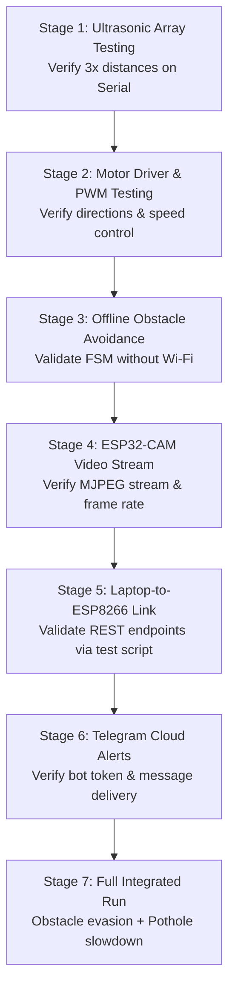

# Hardware Bring-Up, Calibration & Test Plan

This document provides a systematic 7-stage bring-up guide to validate each hardware module, communication link, and software algorithm before executing a full autonomous run.

---

## 1. Safety Guidelines Prior to Testing
1. **Chassis Blocks**: Always place the robot vehicle on a test stand (or elevate wheels off the ground) during motor and ultrasonic testing so it cannot drive off the workbench unexpectedly.
2. **Battery Voltage**: Verify battery voltage with a multimeter before powering the L298N driver ($7.4\text{V} - 11.1\text{V}$). Never connect raw battery voltage directly to the ESP8266 or ESP32-CAM.
3. **Buck Converter Output**: Before connecting the buck converter output to the ESP8266 VIN or ESP32-CAM 5V pins, measure the output with a voltmeter and adjust the trim potentiometer until it reads **$5.05\text{V} \pm 0.05\text{V}$**.
4. **Boot Pin Isolation**: Ensure the motor driver power switch is kept OFF while uploading firmware to the NodeMCU to eliminate any bootstrapping pin interference.

---

## 2. Seven-Stage Systematic Bring-Up Procedure



---

### Stage 1: Ultrasonic Sensor Array Validation
**Objective**: Verify that the shared-trigger parallel sampling accurately reads distances across all three HC-SR04 sensors without crosstalk or timeouts.

1. **Setup**:
   - Power the ESP8266 and HC-SR04 sensors via the 5V rail.
   - Open Arduino IDE Serial Monitor at `115200` baud.
2. **Procedure**:
   - Place a flat cardboard box $10\text{ cm}$, $20\text{ cm}$, and $50\text{ cm}$ in front of the **FRONT** sensor. Verify Serial Monitor output matches physical ruler measurements within $\pm 1\text{ cm}$.
   - Repeat for **LEFT** and **RIGHT** sensors individually.
   - Move an obstacle simultaneously near both Front and Left sensors to verify the parallel sampler acquires both without crosstalk locking.
3. **Pass Criteria**:
   - Readings update at $10–15\text{ Hz}$ smoothly.
   - No `0.0 cm` or negative glitches appear when objects are within $3\text{ cm} - 300\text{ cm}$.

---

### Stage 2: Motor Direction & PWM Speed Validation
**Objective**: Confirm correct motor wiring, directional logic, and PWM speed linearity.

1. **Setup**:
   - Vehicle wheels elevated off the surface.
   - Power on L298N motor rail ($7.4\text{V}–11.1\text{V}$).
2. **Procedure**:
   - Use the manual HTTP endpoints or a diagnostic sketch to test each movement:
     - `Forward`: Both left and right wheels rotate forward.
     - `Reverse`: Both wheels rotate backward.
     - `Turn Left`: Left wheels reverse/halt, right wheels drive forward.
     - `Turn Right`: Right wheels reverse/halt, left wheels drive forward.
   - Sweep PWM speeds:
     - Minimum starting torque (typically `PWM = 90–100`).
     - Crawl speed (`PWM = 110`).
     - Normal cruise speed (`PWM = 180`).
     - Maximum speed (`PWM = 255`).
3. **Pass Criteria**:
   - If a motor spins in the opposite direction, swap that motor's two wire terminals on the L298N `OUT` screw blocks.
   - Both motors start spinning smoothly at `PWM >= 110`.

---

### Stage 3: Offline Obstacle Avoidance Validation
**Objective**: Confirm the state machine transitions (`CRUISE` $\to$ `AVOID` $\to$ `PASS` $\to$ `RETURN` $\to$ `CRUISE`) without requiring a Wi-Fi connection.

1. **Procedure**:
   - Place the robot on an open floor with no Wi-Fi configured.
   - Allow vehicle to drive forward in `CRUISE`.
   - Place a box $20\text{ cm}$ directly in front of the vehicle.
   - Verify:
     1. Vehicle halts forward drive immediately when front sensor $< 25\text{ cm}$.
     2. Vehicle inspects Left vs Right clearance.
     3. Vehicle steers toward the more open side.
     4. Vehicle moves forward until obstacle is passed.
     5. Vehicle counter-steers to restore its original line of travel.
   - Test dead-end trap: Block Front, Left, and Right simultaneously with boxes within $15\text{ cm}$.
   - Verify vehicle halts completely (`BLOCKED` state) and retries every $2\text{ seconds}$.

---

### Stage 4: ESP32-CAM Video Stream Diagnostics
**Objective**: Validate camera initialization, Wi-Fi connectivity, MJPEG streaming rate, and frame latency.

1. **Procedure**:
   - Flash `esp32cam_stream.ino` to the ESP32-CAM.
   - Open Serial Monitor at `115200` baud to observe the assigned IP address (e.g., `192.168.1.50`).
   - Open a browser on the laptop and navigate to `http://192.168.1.50:81/stream`.
   - Verify video feed displays clear roadway preview with minimal lag.
   - Run the diagnostic script:
     ```bash
     cd laptop_ai
     python test_stream.py
     ```
2. **Pass Criteria**:
   - Diagnostic script measures $\ge 15\text{ FPS}$ with frame delay $< 100\text{ ms}$.
   - No broken frame exceptions or brownout restarts when waving hand in front of the lens.

---

### Stage 5: Laptop-to-ESP8266 REST Link Validation
**Objective**: Verify non-blocking HTTP command handling between the laptop Python runtime and the vehicle controller.

1. **Procedure**:
   - Flash `esp8266_controller.ino`. Note the IP assigned (e.g. `192.168.1.60`).
   - From the laptop, run:
     ```bash
     cd laptop_ai
     python test_esp8266_link.py --ip 192.168.1.60
     ```
   - The test script sends:
     1. `GET /status` (reads distance and mode JSON).
     2. `GET /pothole?state=1` (verifies vehicle enters `SLOW` state).
     3. `GET /pothole?state=0` (verifies vehicle resumes `CRUISE`).
     4. `GET /drive?cmd=F` and `cmd=S` (tests manual actuator commands).
2. **Pass Criteria**:
   - All HTTP requests complete in $< 150\text{ ms}$ round-trip.
   - Motor speed visibly switches between normal PWM ($180$) and crawl PWM ($110$).

---

### Stage 6: Telegram Cloud Alert Verification
**Objective**: Confirm HTTPS TLS communication to the Telegram Bot API and ensure alert queueing does not block motor execution.

1. **Procedure**:
   - Configure your `BOT_TOKEN` and `CHAT_ID` in `config.h`.
   - Reset the ESP8266.
   - Check Telegram on your phone or desktop: verify reception of the boot message:
     `"🤖 Pothole Avoidance Robot Online! IP: 192.168.1.60"`.
   - Manually block all 3 sensors to trigger the `BLOCKED` condition.
   - Verify reception of the alert message within $3\text{ seconds}$.
   - Observe motor execution: verify PWM signals never pause or stutter during HTTPS handshakes.

---

### Stage 7: Full System Integrated Test
**Objective**: End-to-end mission verification under real operating conditions.

1. **Setup**:
   - Place a dark circular cutout or black vinyl sticker ($15–25\text{ cm}$ diameter) on the floor representing a pothole.
   - Place an obstacle box $1.5\text{ meters}$ behind the pothole.
   - Start the main AI vision engine:
     ```bash
     cd laptop_ai
     python detect_stream.py
     ```
2. **Observed Behavior**:
   - Vehicle drives forward in `CRUISE` mode ($180\text{ PWM}$).
   - As the camera approaches the pothole, laptop detects the dark defect in the lower-half ROI.
   - After 3 confirmed frames, laptop sends `GET /pothole?state=1`.
   - Vehicle decelerates smoothly to crawl speed ($110\text{ PWM}$), driving over the rough patch safely without stopping.
   - Telegram notification `"⚠️ Pothole detected - slowing down"` is received.
   - Once the pothole passes beneath the camera FOV, 10 clear frames trigger `GET /pothole?state=0`, and vehicle ramps back to cruise speed.
   - As the vehicle approaches the obstacle box ($< 25\text{ cm}$), it pivots outward, bypasses the box, and counter-steers back to lane.

---

## 3. Calibration & Parameter Tuning Reference

| Parameter | Location | Default Value | Recommended Tuning Range | Effect & Calibration Guidance |
|---|---|---|---|---|
| `PWM_CRUISE` | `config.h` | `180` | `150 – 220` | Normal drive speed. Adjust according to floor friction and battery voltage. |
| `PWM_SLOW` | `config.h` | `110` | `85 – 130` | Pothole crawl speed. Must be high enough to overcome motor static friction. |
| `OBSTACLE_FRONT_THRESH` | `config.h` | `25` (cm) | `20 – 35` (cm) | Obstacle evasion trigger distance. Increase for higher cruise speeds to allow stopping distance. |
| `OBSTACLE_SIDE_THRESH` | `config.h` | `18` (cm) | `15 – 25` (cm) | Clearance distance required for Left/Right escape path. |
| `TURN_DURATION_MS` | `config.h` | `450` (ms) | `300 – 700` (ms) | Time spent in pivot turn. Calibrate on your surface until vehicle pivots $\sim 45^\circ$. |
| `PASS_TIMEOUT_MS` | `config.h` | `1800` (ms) | `1200 – 2500` (ms) | Maximum forward drive duration during obstacle bypass before counter-steer. |
| `ROI_Y_MIN_RATIO` | `config.py` | `0.50` | `0.45 – 0.65` | Vertical cutoff for road detection. Eliminates background horizon and false positives. |
| `CONF_THRESHOLD` | `config.py` | `0.45` | `0.35 – 0.60` | AI model detection confidence threshold. |
| `CONFIRM_FRAMES_N` | `config.py` | `3` | `2 – 5` | Number of consecutive detection frames required to trigger slowdown. |
| `CLEAR_FRAMES_M` | `config.py` | `10` | `6 – 15` | Number of consecutive clear frames required to resume cruise speed. |
| `ALERT_COOLDOWN_SEC` | `config.py` / `config.h` | `15` (s) | `10 – 30` (s) | Rate limit preventing Telegram notification spam. |
