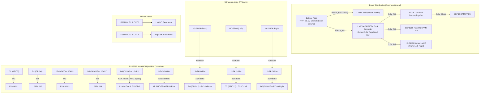

# Hardware Wiring Diagram & Electrical Specifications

This document outlines the complete electrical interconnections, power distribution, voltage-level translation, and strapping-pin safeguards for the **AI-Driven Pothole Identification and Smart Obstacle Avoidance System**.

---

## 1. System Interconnection Architecture



---

## 2. Complete Pin Mapping Table

### A) ESP8266 NodeMCU v2 / v3

| NodeMCU Pin | ESP8266 GPIO | Connected Component | Signal / Logic | Electrical Protection & Strapping Safeguards |
|---|---|---|---|---|
| **D1** | GPIO5 | L298N IN1 | Left Motor Dir A | Direct connection. Safe boot pin. |
| **D2** | GPIO4 | L298N IN2 | Left Motor Dir B | Direct connection. Safe boot pin. |
| **D3** | GPIO0 | L298N IN3 | Right Motor Dir A | **CRITICAL BOOT PIN**: Must be HIGH at power-up. Add an external **10 kΩ pull-up resistor to 3.3V** to prevent L298N input circuitry from holding it low (which would force UART flash download mode). |
| **D8** | GPIO15 | L298N IN4 | Right Motor Dir B | **CRITICAL BOOT PIN**: Must be LOW at power-up. Add an external **4.7 kΩ to 10 kΩ pull-down resistor to GND** to guarantee logic low during reset. |
| **D4** | GPIO2 | L298N ENA + ENB | Speed PWM (0–255) | **BOOT PIN**: Must be HIGH at power-up. Remove L298N jumper caps from ENA/ENB, tie both ENA and ENB to D4. Add a **10 kΩ pull-up resistor to 3.3V** (NodeMCU onboard blue LED is also attached here). |
| **D5** | GPIO14 | HC-SR04 Shared TRIG | 10 µs Trigger Pulse | Drives the TRIG pin of FRONT, LEFT, and RIGHT sensors in parallel. Output is 3.3V, which reliably triggers HC-SR04 (TTL threshold is ~2.0V). |
| **D6** | GPIO12 | HC-SR04 FRONT ECHO | Echo Pulse Input | Connect via **Voltage Divider (1kΩ series + 2kΩ to GND)**. Direct 5V from sensor will damage the ESP8266! |
| **D7** | GPIO13 | HC-SR04 LEFT ECHO | Echo Pulse Input | Connect via **Voltage Divider (1kΩ series + 2kΩ to GND)**. Direct 5V from sensor will damage the ESP8266! |
| **D0** | GPIO16 | HC-SR04 RIGHT ECHO | Echo Pulse Input | Connect via **Voltage Divider (1kΩ series + 2kΩ to GND)**. Direct 5V from sensor will damage the ESP8266! |
| **VIN** | - | 5V Buck Converter Output | Power Input (5V) | Regulated 5.0V from buck converter. |
| **GND** | - | System Ground | Common Ground | Connected to common star ground. |

---

### B) ESP32-CAM (AI-Thinker Model)

| ESP32-CAM Pin | Connected To | Purpose / Description |
|---|---|---|
| **5V** | 5V Buck Converter Output | Powered directly from the 5V rail. Needs $\ge 500\text{ mA}$ continuous, $\sim 800\text{ mA}$ peak during Wi-Fi transmission. |
| **GND** | Common Star Ground | Common ground reference. |
| **U0R (GPIO3)** | FTDI Programmer TX | Required only during code flashing. |
| **U0T (GPIO1)** | FTDI Programmer RX | Required only during code flashing. |
| **GPIO0** | GND (during flashing only) | Connect to GND to enter download mode; leave floating/disconnected during normal operation. |
| **Onboard Flash LED** | GPIO4 | Internal camera flash / status LED. |

> [!IMPORTANT]
> **ESP32-CAM Brownout Protection:**
> The ESP32-CAM is notorious for brownout resets when switching on the Wi-Fi radio. Always place a **$470\ \mu\text{F}$ (or $1000\ \mu\text{F}$) 16V electrolytic capacitor** directly across the ESP32-CAM `5V` and `GND` pins.

---

### C) L298N Dual H-Bridge Motor Driver

| L298N Terminal | Connected To | Description |
|---|---|---|
| **VMS (12V Input)** | Battery Positive (+) | 7.4V to 11.1V from Li-ion/LiPo battery pack. |
| **GND** | Battery Negative (-) & Common GND | Common ground reference. |
| **5V (Logic In/Out)** | Disconnected or 5V | If battery is $> 12\text{V}$, remove the onboard 5V regulator jumper. If battery is 7.4V–11.1V, onboard regulator jumper may remain ON. Do NOT connect L298N 5V output to the buck converter output. |
| **ENA** | D4 (GPIO2) via jumper bridge to ENB | Left motor speed control via ESP8266 hardware PWM. (Remove stock black jumper). |
| **ENB** | D4 (GPIO2) tied together with ENA | Right motor speed control via ESP8266 hardware PWM. (Remove stock black jumper). |
| **IN1** | D1 (GPIO5) | Left Motor direction control 1. |
| **IN2** | D2 (GPIO4) | Left Motor direction control 2. |
| **IN3** | D3 (GPIO0) [with 10k pull-up] | Right Motor direction control 1. |
| **IN4** | D8 (GPIO15) [with 10k pull-down] | Right Motor direction control 2. |
| **OUT1 & OUT2** | Left DC Gearmotor Terminals | Output to left chassis motor. |
| **OUT3 & OUT4** | Right DC Gearmotor Terminals | Output to right chassis motor. |

---

## 3. Voltage Level Shifter Schematic (HC-SR04 ECHO lines)

The HC-SR04 ultrasonic sensor requires $5.0\text{V}$ $V_{CC}$ to operate reliably. Its `ECHO` output pin transitions between $0\text{V}$ and $5\text{V}$. Because the ESP8266 GPIO inputs are rated for a maximum of $3.3\text{V}$, feeding a $5\text{V}$ echo signal directly will degrade or permanently destroy the ESP8266 internal I/O clamping structures.

Construct three identical passive resistor dividers as follows:

```
                  1.0 kΩ (1/4 W)
ECHO PIN (5V) --------/\/\/\/\-------+--------> ESP8266 GPIO Pin (3.3V Max)
(Front, Left, or Right)              |
                                     |
                                  [ 2.0 kΩ ] (or two 1.0 kΩ in series)
                                  [ (1/4 W)]
                                     |
                                     +--------> Common GND
```

**Formula Verification:**
$$V_{\text{ESP}} = V_{\text{ECHO}} \times \frac{R_2}{R_1 + R_2} = 5.0\text{ V} \times \frac{2000\,\Omega}{1000\,\Omega + 2000\,\Omega} = 5.0\text{ V} \times \frac{2}{3} \approx 3.33\text{ V}$$
*(Within the ESP8266 safe operating voltage tolerance $3.3\text{ V} \pm 5\%$.)*

---

## 4. Comprehensive ASCII Hardware Wiring Diagram

```
       ========================================================================================
                                     POWER & GROUND DISTRIBUTION
       ========================================================================================
       
       [ + ] 7.4V - 11.1V Battery ------------------------+-------------> L298N VMS (Motor Power)
                                                          |
                                                          |  (IN+)
                                                   +---------------+
                                                   | DC-DC BUCK    | (LM2596 / MP1584)
                                                   | CONVERTER     | (Adjust pot to 5.05V)
                                                   +---------------+
                                                          |  (OUT+)
                                                          +-------------> +5.0V Bus
       
       [ - ] Battery Negative ----------------------------+-------------> Common Star Ground (GND Bus)
                                                          |
                                                    (IN- / OUT-)
       
       ========================================================================================
                                    5.0V BUS & GROUND DISTRIBUTION
       ========================================================================================
       +5.0V Bus ---------------------+---------------------+---------------------+
                                      |                     |                     |
                               [ ESP8266 VIN ]       [ ESP32-CAM 5V ]      [ HC-SR04 VCC (x3) ]
                                                            |
                                                     [ 470µF 16V Cap ]
                                                            |
       GND Bus -----------------------+---------------------+---------------------+
                                      |                     |                     |
                               [ ESP8266 GND ]       [ ESP32-CAM GND ]     [ HC-SR04 GND (x3) ]
                                      |
                               [ L298N GND ]

       ========================================================================================
                             ESP8266 CONTROLLER TO L298N MOTOR DRIVER
       ========================================================================================
       
       ESP8266 NodeMCU                                                   L298N H-Bridge Driver
       +-----------------------+                                         +-------------------+
       |              D1/GPIO5 |---------------------------------------->| IN1 (Left Fwd)    |
       |              D2/GPIO4 |---------------------------------------->| IN2 (Left Rev)    |
       |                       |                                         |                   |
       |  +3.3V --[ 10k PU ]--+|                                         |                   |
       |              D3/GPIO0 |---------------------------------------->| IN3 (Right Fwd)   |
       |                       |                                         |                   |
       |   GND --[ 10k PD ]---+|                                         |                   |
       |             D8/GPIO15 |---------------------------------------->| IN4 (Right Rev)   |
       |                       |                                         |                   |
       |  +3.3V --[ 10k PU ]--+|                                         |                   |
       |              D4/GPIO2 |--------------------+------------------->| ENA (Left PWM)    |
       |                       |                    +------------------->| ENB (Right PWM)   |
       +-----------------------+                                         +-------------------+

       ========================================================================================
                           ESP8266 CONTROLLER TO ULTRASONIC SENSOR ARRAY
       ========================================================================================
       
       ESP8266 NodeMCU                                                   HC-SR04 Sensors
       +-----------------------+                                         +-------------------+
       |             D5/GPIO14 |---+------------------------------------>| FRONT TRIG        |
       |        (Shared Trigger)   +------------------------------------>| LEFT TRIG         |
       |                           +------------------------------------>| RIGHT TRIG        |
       |                       |                                         +-------------------+
       |                       |   1.0 kΩ                  5V Echo       +-------------------+
       |             D6/GPIO12 |---/\/\/\---+----------------------------| FRONT ECHO        |
       |                       |            |                            +-------------------+
       |                       |         [2.0 kΩ]
       |                       |            |
       |                       |           GND
       |                       |
       |                       |   1.0 kΩ                  5V Echo       +-------------------+
       |             D7/GPIO13 |---/\/\/\---+----------------------------| LEFT ECHO         |
       |                       |            |                            +-------------------+
       |                       |         [2.0 kΩ]
       |                       |            |
       |                       |           GND
       |                       |
       |                       |   1.0 kΩ                  5V Echo       +-------------------+
       |             D0/GPIO16 |---/\/\/\---+----------------------------| RIGHT ECHO        |
       |                       |            |                            +-------------------+
       |                       |         [2.0 kΩ]
       |                       |            |
       |                       |           GND
       +-----------------------+
```

---

## 5. Physical Sensor Mounting Geometry

To avoid physical acoustic interference and maximize blind-spot coverage:
- **FRONT Sensor**: Center mounted on chassis bumper, pointing straight ahead ($0^\circ$), positioned $5\text{ cm}$ above road level.
- **LEFT Sensor**: Mounted on the front-left chassis corner, angled outward at $+45^\circ$ to $+60^\circ$ relative to forward heading.
- **RIGHT Sensor**: Mounted on the front-right chassis corner, angled outward at $-45^\circ$ to $-60^\circ$ relative to forward heading.
- **ESP32-CAM**: Mounted centered directly above the front sensor, angled downwards at $\sim 15^\circ$ to capture the road surface $0.3\text{ m}$ to $2.0\text{ m}$ ahead of the chassis.
