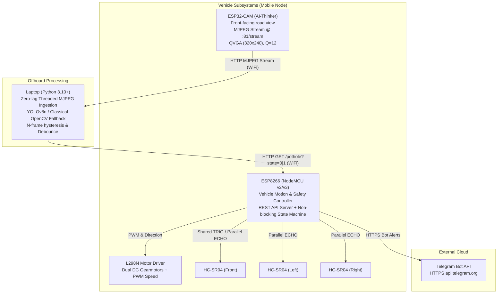
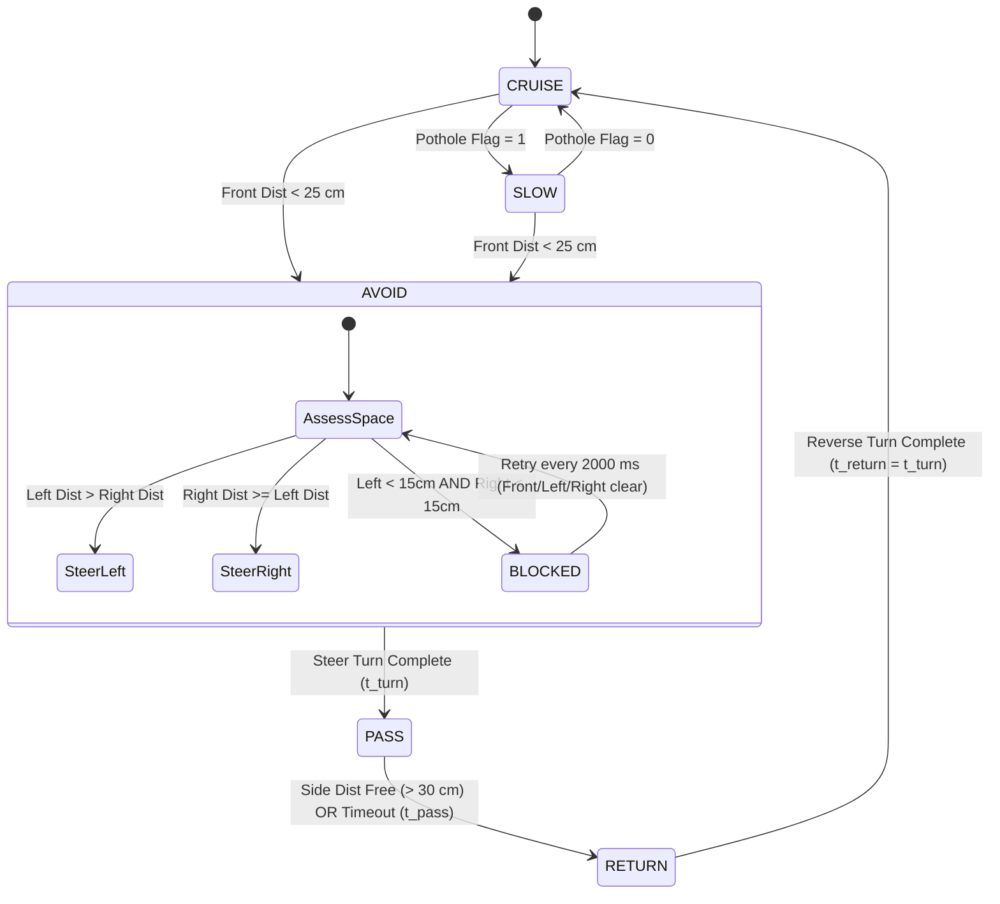

# Implementation Plan: AI-Driven Pothole Identification and Smart Obstacle Avoidance System

## 1. System Architecture Overview

The system consists of three networked nodes operating on the same 2.4 GHz Wi-Fi local network:



### Communication & Data Flow Specifications
1. **Video Streaming (`ESP32-CAM -> Laptop`)**:
   - HTTP MJPEG stream at `http://<ESP32CAM_IP>:81/stream`.
   - Resolution: QVGA (320x240) to minimize Wi-Fi transmission latency (< 80 ms latency target).
   - Frame rate target: 15–25 FPS.
2. **AI Control Commands (`Laptop -> ESP8266`)**:
   - Asynchronous HTTP GET requests sent **strictly upon state changes** (not per-frame) with a 400 ms connection timeout:
     - `GET /pothole?state=1`: Slow down (pothole detected and confirmed over $N$ consecutive frames).
     - `GET /pothole?state=0`: Resume normal speed (pothole cleared over $M$ consecutive clear frames).
3. **Vehicle Telemetry & Testing (`ESP8266 HTTP Endpoints`)**:
   - `GET /status`: Returns JSON `{ "mode": "AUTO", "state": "CRUISE", "speed": 180, "pothole": 0, "front_cm": 42.5, "left_cm": 35.0, "right_cm": 40.2, "uptime_s": 124 }`.
   - `GET /mode?auto=1|0`: Toggles between autonomous navigation and manual override.
   - `GET /drive?cmd=F|B|L|R|S`: Manual drive test commands.
4. **Cloud Alerts (`ESP8266 -> Telegram Bot API`)**:
   - Direct TLS/HTTPS POST requests to `https://api.telegram.org/bot<TOKEN>/sendMessage`.
   - Queued and non-blocking in the main loop to prevent motor stalling during TLS handshakes.
   - Rate-limited (minimum 15-second cooldown between duplicate alert classes).

---

## 2. Hardware Pin Map, Bootstrapping Analysis & Electrical Design

### ESP8266 Bootstrapping Pin Critical Verification
The ESP8266 has strict hardware strapping requirements at power-up/reset:
- **GPIO0 (D3)**: Must be **HIGH** at boot for SPI Flash boot. If pulled LOW, it boots into UART Download Flashing Mode.
- **GPIO2 (D4)**: Must be **HIGH** at boot. Connected to onboard blue LED.
- **GPIO15 (D8)**: Must be **LOW** at boot. If pulled HIGH, flash boot fails.
- **GPIO16 (D0)**: Deep sleep wake pin, no internal pull-up resistor, no hardware PWM/interrupt.

#### Analysis of the Suggested Pin Map
| NodeMCU Pin | GPIO | Function in Suggested Map | Strapping Requirement | Potential Conflict & Failure Mode | Senior Engineer Mitigation |
|---|---|---|---|---|---|
| **D1** | GPIO5 | L298N IN1 | Safe GPIO | None (Clean at boot, PWM supported) | Direct connection |
| **D2** | GPIO4 | L298N IN2 | Safe GPIO | None (Clean at boot, PWM supported) | Direct connection |
| **D3** | GPIO0 | L298N IN3 | **Must be HIGH at boot** | L298N input impedance or internal pulldowns can hold GPIO0 LOW, causing the ESP8266 to enter UART flash mode and never start! | Add **10k pull-up resistor to 3.3V**; ensure motor driver power rail is powered on after ESP or add a simple isolation buffer. |
| **D8** | GPIO15 | L298N IN4 | **Must be LOW at boot** | If L298N module has internal pull-ups or leakage to 5V, GPIO15 goes HIGH, preventing SPI flash boot. | Add **4.7k–10k external pull-down resistor to GND** on D8. |
| **D4** | GPIO2 | L298N ENA+ENB | **Must be HIGH at boot** | L298N ENA/ENB enable pins have internal pulldowns on some boards. Pulling GPIO2 LOW prevents boot. | Dedicated 10k pull-up to 3.3V, or tie ENA/ENB to 5V and drive PWM directly on IN1..IN4. |
| **D5** | GPIO14 | Shared TRIG | Safe GPIO | None (Clean at boot, SPI CLK) | Direct connection |
| **D6** | GPIO12 | ECHO Front | Safe GPIO | None (Clean at boot) | **5V -> 3.3V Voltage Divider (1kΩ + 2kΩ)** |
| **D7** | GPIO13 | ECHO Left | Safe GPIO | None (Clean at boot) | **5V -> 3.3V Voltage Divider (1kΩ + 2kΩ)** |
| **D0** | GPIO16 | ECHO Right | RTC / Wake | High impedance, lacks internal pull-up | **5V -> 3.3V Voltage Divider (1kΩ + 2kΩ)** |

### Shared TRIG vs. Acoustic Crosstalk & Measurement Analysis
1. **The `pulseIn()` Sequential Trap**:
   - Standard Arduino `pulseIn(pin, HIGH, timeout)` is blocking. If all 3 HC-SR04 sensors share the TRIG line, pulsing TRIG fires all 3 ultrasound bursts simultaneously.
   - If you call `pulseIn(ECHO_FRONT)`, the sound travels out and returns in ~1–3 ms. By the time `pulseIn(ECHO_FRONT)` finishes and the code calls `pulseIn(ECHO_LEFT)`, the echo pulse on ECHO_LEFT has already ended! Thus, ECHO_LEFT and ECHO_RIGHT will consistently time out (reading 0 cm).
2. **Senior Embedded Solution: Non-blocking Parallel Polling (`readUltrasonicsParallel`)**:
   - The firmware will implement a dedicated parallel polling sampler:
     1. Pulse shared TRIG (D5) HIGH for 10 µs, then LOW.
     2. Wait for ECHO lines to go HIGH.
     3. Enter a microsecond polling loop tracking `start_time` and `end_time` for D6, D7, and D0 simultaneously using direct port registers or fast `digitalRead()` until all 3 have fallen or the 30 ms (500 cm) timeout elapses.
     4. Calculate distance for all 3 sensors from a single trigger pulse.
3. **Acoustic Crosstalk Mitigation**:
   - In tight indoor corridors, 40 kHz pulses emitted simultaneously by 3 transducers angled outward can reflect off side walls and trigger the front receiver early.
   - We implement a median-of-3 filter with delta validation (rejecting single-frame erratic drops) and offer an alternative sequential multi-pin wiring option (or PCF8574 I2C expander) in documentation.

### Voltage Divider Circuit (for all 3 ECHO lines)
HC-SR04 ECHO outputs 5 V logic. The ESP8266 is not 5V tolerant on its GPIO inputs.
```
HC-SR04 ECHO (5V) ----[ 1.0 kΩ ]----+---- ESP8266 GPIO (3.3V max)
                                   |
                               [ 2.0 kΩ ]
                                   |
                                  GND
V_out = 5V * (2.0k / (1.0k + 2.0k)) = 3.33 V (Safe)
```

### Power Distribution Schematic
- **Battery Pack (7.4V 2S Li-ion or 11.1V 3S LiPo / 6xAA 7.2–9V)**:
  - Supplies L298N `VMS` (Motor power).
  - Supplies input to a high-efficiency 5V Step-Down (Buck) Converter (e.g., LM2596 or MP1584, rated $\ge 2\text{A}$).
- **Regulated 5V Buck Rail**:
  - Powers ESP8266 `VIN` / `5V` pin.
  - Powers ESP32-CAM `5V` pin (requires $\ge 500\text{ mA}$ continuous, $\sim 800\text{ mA}$ burst during Wi-Fi transmission). Includes a $470\ \mu\text{F}$ low-ESR electrolytic capacitor across 5V and GND near the ESP32-CAM to prevent brownout reboots.
  - Powers HC-SR04 `VCC` (5V required for accurate ultrasonic ranging).
- **COMMON GROUND**:
  - Battery GND, Buck Converter GND, ESP8266 GND, ESP32-CAM GND, and L298N GND are all tied together to a common star ground.

---

## 3. Finite State Machine (ESP8266)

The vehicle operates on a cooperative non-blocking state machine clocked via `millis()`:



### State Definitions & Priority Hierarchy
1. **Priority 1 (Emergency Safety - Obstacle Avoidance)**:
   - If `Front < 25 cm`, the system immediately transitions to `AVOID`, regardless of whether a pothole is present.
   - Potholes **never** stop the vehicle; obstacles **always** preempt pothole slowdown.
2. **Priority 2 (Pothole Slowdown)**:
   - In `CRUISE`, standard forward speed is PWM = 180–200 (~70–80%).
   - When laptop signals `pothole=1`, state switches to `SLOW` (PWM = 100–120, ~40–45%).
   - When laptop signals `pothole=0`, smoothly ramps back to `CRUISE`.
3. **Fail-Safes**:
   - **Laptop Heartbeat Watchdog**: If no command is received from the laptop for $> 5000\text{ ms}$, vehicle resets `pothole_flag = 0` and continues in `CRUISE` with ultrasonic avoidance fully active.
   - **Wi-Fi Loss Resilience**: If Wi-Fi disconnects, the vehicle controller continues autonomous obstacle avoidance uninterrupted while `WiFi.begin()` attempts background reconnection.
   - **Non-blocking Telegram Queue**: Alerts are pushed to a FIFO ring buffer. A dedicated dispatch function handles TLS requests in between motor ticks without freezing PWM.

---

## 4. Laptop AI & Vision Pipeline

### Pipeline Architecture
1. **Threaded Video Ingestion**:
   - Dedicated `FreshFrameCapture` thread continuously reads frames from OpenCV `VideoCapture(stream_url)`.
   - Discards intermediate buffered frames and stores only the single latest frame in a thread-safe mutex buffer, eliminating stream lag.
   - Implements automatic reconnection with exponential backoff if the Wi-Fi stream drops.
2. **Pothole Detection (Primary & Fallback)**:
   - **Primary Model**: Ultralytics YOLOv8n fine-tuned on road pothole datasets (e.g. Roboflow Universe Pothole v1/v2), input resolution 320x320.
   - **Inference Optimization**: ONNX Runtime CPU engine for $\ge 15\text{ FPS}$ on standard laptop CPUs.
   - **Classical Fallback**: Adaptive Canny edge detection + Otsu dark-region thresholding + morphological closure + contour aspect-ratio/area filtering inside the bottom 50% road ROI. Ensures out-of-the-box functionality before model weights are trained.
3. **Temporal Filtering & False Positive Rejection**:
   - **Road ROI Constraint**: Pothole bounding box centroids must reside in the lower half of the frame (`y > 0.5 * height`).
   - **Confirmation Hysteresis ($N=3$ frames)**: Must detect a pothole in 3 consecutive frames before triggering `GET /pothole?state=1`.
   - **Clearance Hysteresis ($M=10$ frames)**: Must observe 10 consecutive frames with zero detections before sending `GET /pothole?state=0`.
   - **State-Change Only Transmission**: HTTP requests are dispatched in a daemon thread only on state transition ($0 \to 1$ or $1 \to 0$).

---

## 5. Repository File Structure

```
pothole-avoidance/
 ├─ README.md                                  # Complete overview, quickstart, system diagram, troubleshooting
 ├─ telegram_setup.md                          # BotFather creation, chat ID retrieval, and API test verification
 ├─ docs/
 │   ├─ wiring_diagram.md                      # Detailed pin connections, voltage dividers, bootstrapping notes, ASCII/Mermaid diagrams
 │   ├─ architecture.md                        # Multi-node network data flow, REST API spec, state machine diagram
 │   └─ test_plan.md                           # 7-stage bring-up and calibration manual
 ├─ esp32cam_stream/
 │   └─ esp32cam_stream.ino                    # Lightweight MJPEG stream firmware on port 81, QVGA, Q=12, auto-reconnect
 ├─ esp8266_controller/
 │   ├─ config.h                               # Tunable settings: Wi-Fi credentials, Telegram secrets, pin definitions, thresholds
 │   └─ esp8266_controller.ino                 # Main controller: non-blocking state machine, parallel ultrasonic reader, HTTP server, Telegram queue
 └─ laptop_ai/
     ├─ requirements.txt                       # Python dependencies (opencv-python, numpy, requests, ultralytics, onnxruntime)
     ├─ config.py                              # Centralized configuration: stream URLs, ESP8266 IP, thresholds, ROI, hysteresis
     ├─ esp_client.py                          # Thread-safe, non-blocking HTTP REST client for ESP8266
     ├─ pothole_fallback.py                    # Classical OpenCV contour & dark-region road detector
     ├─ train_model.py                         # Dataset downloader instructions, YOLOv8n training pipeline, and ONNX export
     ├─ detect_stream.py                       # Main real-time detection script with threaded video ingest, visual HUD, and control loop
     ├─ test_stream.py                         # ESP32-CAM stream latency and frame reception diagnostic tool
     └─ test_esp8266_link.py                   # Mock client to test ESP8266 REST endpoints and state changes
```

---

## 6. Implementation & Task Execution Plan

- [x] **Phase 1: Architecture & Planning**: Detail system topology, strapping pin solutions, parallel ultrasonic design, and deliver implementation plan for user approval.
- [ ] **Phase 2: System Documentation (`docs/` & `telegram_setup.md`)**:
  - `docs/wiring_diagram.md`: Full pinout tables, resistor values, bootstrapping safeguards, power distribution.
  - `docs/architecture.md`: REST API schema, finite state machine specifications, fail-safe rules.
  - `docs/test_plan.md`: Step-by-step 7-phase validation guide with calibration constants.
  - `telegram_setup.md`: Guide to setting up the Telegram bot, obtaining Chat ID, and testing with curl.
- [ ] **Phase 3: ESP32-CAM Video Streamer (`esp32cam_stream/`)**:
  - `esp32cam_stream.ino`: Lightweight web streamer on port 81, AI-Thinker pin definitions, QVGA, JPEG quality 12, Wi-Fi auto-recovery.
- [ ] **Phase 4: ESP8266 Vehicle Controller (`esp8266_controller/`)**:
  - `config.h`: Central parameters, credentials placeholders, pin mapping, speed PWM values.
  - `esp8266_controller.ino`: State machine, parallel ultrasonic acquisition, L298N driver, HTTP REST endpoints, non-blocking Telegram queue.
- [ ] **Phase 5: Laptop AI Computer Vision Subsystem (`laptop_ai/`)**:
  - `requirements.txt`: Python package specs.
  - `config.py`: AI, network, and detection parameters.
  - `esp_client.py`: Asynchronous state-change HTTP dispatcher.
  - `pothole_fallback.py`: Classical computer vision detector for immediate out-of-the-box operation.
  - `train_model.py`: YOLOv8n training workflow, dataset preparation, and ONNX export.
  - `test_stream.py`: Camera stream diagnostic utility.
  - `test_esp8266_link.py`: Communication diagnostic utility.
  - `detect_stream.py`: Multi-threaded main inference application with heads-up display.
- [ ] **Phase 6: Master Documentation (`README.md`)**:
  - Top-level user guide, hardware BOM, setup steps, calibration guidelines, and known limitations.
